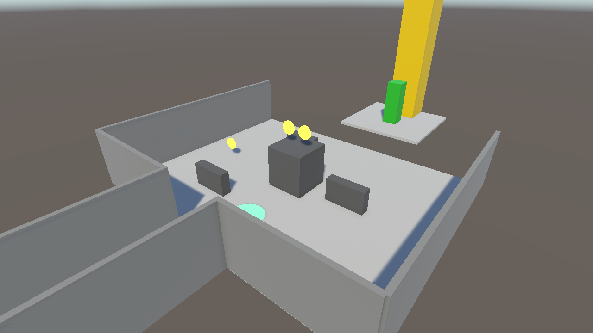
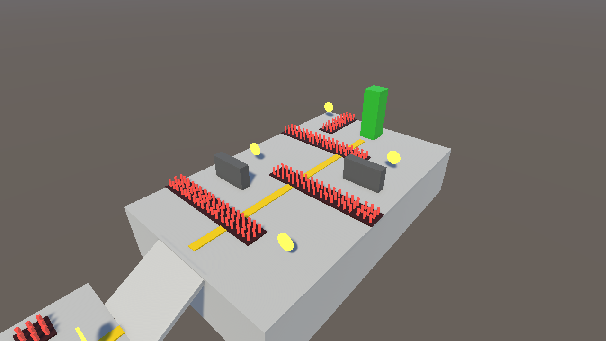
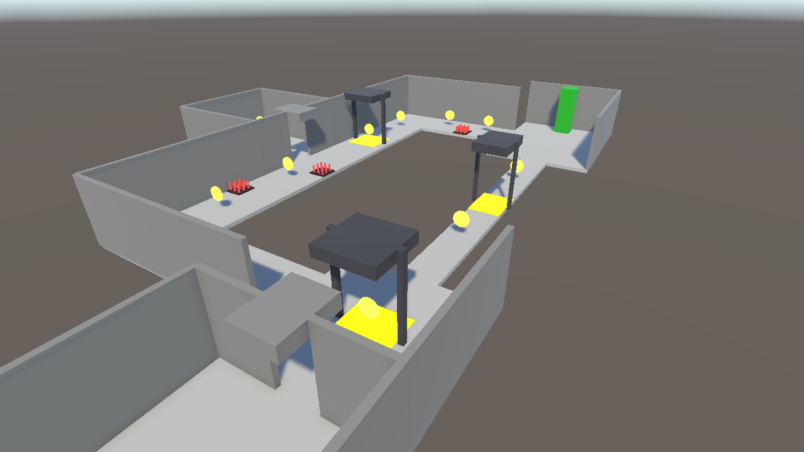
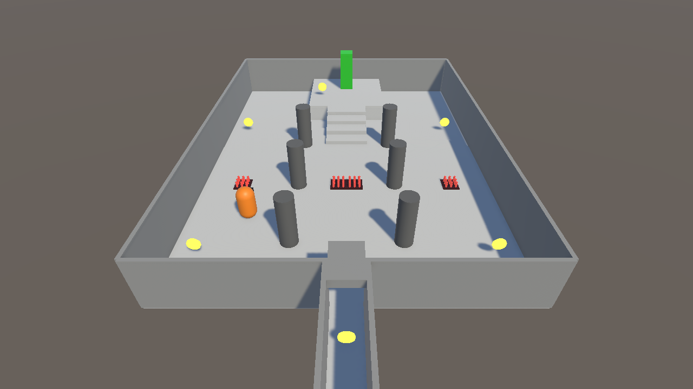
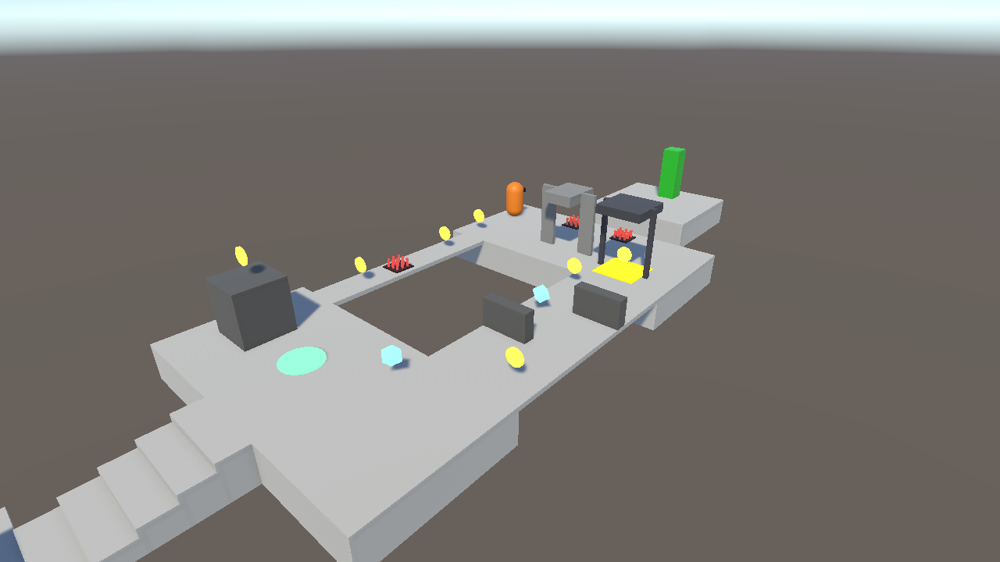

# CS464 Assignment 03 · Muhammad Talha · BSCS23051

- **Video (60–120 s):** [All five levels, Google Drive](https://drive.google.com/file/d/1jdP3D--ADn5wjT_TDDVqgo32Te0jUwHt/view?usp=sharing)
- **Started from:** my Assignment 02 repo, https://github.com/MTalha250/ITU-CS-464-A2-BSCS23051. I kept its player controller (jump, coyote time, fall gravity, camera) and my five greybox levels, so this assignment adds the game on top of them.
- **Controls:** WASD or the arrow keys to move (relative to the camera), Space to jump
- **To win a level:** collect the number of coins shown on the HUD (7 of 7 in Level01, 5 of 6 in Level02, 8 of 11 in Level03, 7 of 8 in Level04, 6 of 8 in Level05), then touch the green goal. Touching it early just tells you how many coins are left.

Every level has 3 hearts and 3 lives. Losing all your hearts or falling off the level costs a life, and you come back at the start after 0.6 s with 1.5 s of protection. Lose the last life and the lose panel comes up. The win and lose panels both have Restart, and the win panel also has Next Level.

## Levels

| Level | Screenshot | New idea | Combined with |
|---|---|---|---|
| Level01 |  | Coins, the goal, and a green bounce pad that launches you up onto a 2.2 m tower with 2 coins on it. Your jump only reaches 1.8 m, so you need the pad. | Nothing hurts yet. The only danger is the 3 m gap before the goal, from Assignment 02. |
| Level02 |  | Spikes and hearts. A spike costs one heart, knocks you back, and then nothing can hurt you for 1 second. | Coins. The first spike strip is in the start room, where you can walk round it. On the high deck the rows make a zig-zag, and one extra coin sits on the edge between spikes and the drop. |
| Level03 |  | The crusher. It flashes orange for 0.7 s, then strikes for 2 hearts. You see the first one in a room where you can walk round it. | Spikes along the long route, a crusher that fills the corridor so you have to time it, one on the narrow bridge, and coins under the crushers. |
| Level04 |  | A guard that patrols a loop round the pillars, chases you if you get close (it turns red), gives up and walks back. | Spikes beside its route, and a crusher in the entry corridor with a coin under it. |
| Level05 |  | Two speed pickups, 6.6 m apart, so you reach the second one while the first is still running. | Everything so far: the bounce pad and tower, spikes on the narrow bridge, a crusher on the far deck, and a ping-pong guard that chases. |

## The numbers

| Number | Value | Why this value |
|---|---|---|
| Patrol speed | 2 m/s | That's 40% of my 5 m/s run, so you can walk next to the guard, learn its loop and pick your moment. |
| Chase range | 4 m (gives up at 6 m) | In Level04 the closest point of the guard's loop is 6 m from the doorway, so you can come into the hall and watch it before it notices you. The 2 m between 4 and 6 stops it flicking between chase and patrol at one edge. |
| Knockback | 8, Impulse (knockTime 0.3 s) | On my 1 kg player that's 8 m/s for 0.3 s with no steering, so about 2.4 m. Measured in play mode it threw me 2.24 m. That clears a 1 m spike tile with room to spare. |
| I-frames | 1 s | The knockback is over after 0.3 s, which leaves 0.7 s to walk off (3.5 m at 5 m/s). When I held the player on the spikes, hits landed at 0.00 s and 1.00 s and nowhere in between. |
| Power-up duration | 5 s at 1.6× (8 m/s) | Long enough to take both pickups (under 1 s apart at 8 m/s) and get past the guard and the crusher to the last gap, about 17 m or just over 2 s. It isn't long enough to cover the whole level, and you lose most of it if you stand and wait for the crusher. |
| Chase speed | 3.5 m/s | Slower than my 5 m/s run, so you can always get away. You pull away at 1.5 m/s, so after a hit (2.24 m) it takes about 2.5 s to reach 6 m and make it give up. |
| Bounce pad | 8.5, VelocityChange | 8.5² / (2 × 9.81) = 3.7 m high, which clears the 2.2 m towers. In Level01 the pad is in the middle of the yard, so you come down below 3 m before you could reach a wall and you can't bounce out of the level. |
| Crusher | rest 2.4 s, warning 0.7 s, strike 0.4 s, damage 2 | Reaction time is about 0.25 s and you still have to move, so 0.7 s is fair. 2.4 s of rest is enough to cross the 2 m pad and grab the coin under it. |

## Short answers

**1. Why does a trigger need a Rigidbody on at least one of the two objects?**

Unity only checks pairs for contacts when at least one of them is a Rigidbody. Two colliders without one are both static as far as physics is concerned, so nothing ever checks them against each other and OnTriggerEnter never runs. In my game the coins, spikes, goal, bounce pad and kill zone have no Rigidbody, so the player's Rigidbody is what makes them fire. The guard has its own kinematic Rigidbody because a script moves it.

**2. Which ForceMode do your knockback and your Part A force use, and why each?**

The knockback is Impulse 8. It's one kick, divided by mass, so 8 m/s on my 1 kg player. It's called once, only when TakeDamage returns true, and Knockback() zeroes my sideways speed first and stops steering for 0.3 s so my move line doesn't wipe it the next step. The bounce pad is VelocityChange 8.5. That's also one kick (in OnTriggerEnter), but it ignores mass, so the number is just the launch speed. It pushes straight up, because my controller rewrites x and z every step, and it zeroes y first so landing on the pad gives the same bounce as walking onto it.

**3. What does your code do when a second power-up is picked up while one is running?**

It refreshes. BoostSpeed in PlayerController stops the running Boost coroutine with StopCoroutine and starts a new one, so you get a full 5 s again from the second pickup. Two 5 s pickups taken 3 s apart end at 8 s. The timer runs on the player, not the pickup, so destroying the pickup doesn't stop it.

**4. Why can `==` fail as an arrival check, and when does it work?**

`==` on two Vector3s is only true when they're within 0.00001 m. If you move by hand a fixed step each frame (speed × deltaTime), you nearly always land a bit short or a bit past the point, so it never counts as arrived and the guard shivers on the spot. It only works right after MoveTowards, because MoveTowards returns the target exactly once it's within one step. My guard uses MoveTowards with MovePosition, but it still checks `Vector3.Distance < 0.1`, which is bigger than one step (0.04 m on patrol and 0.07 m when chasing).
